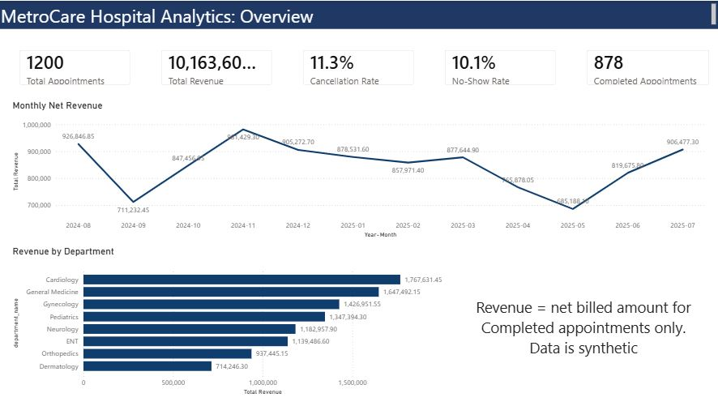
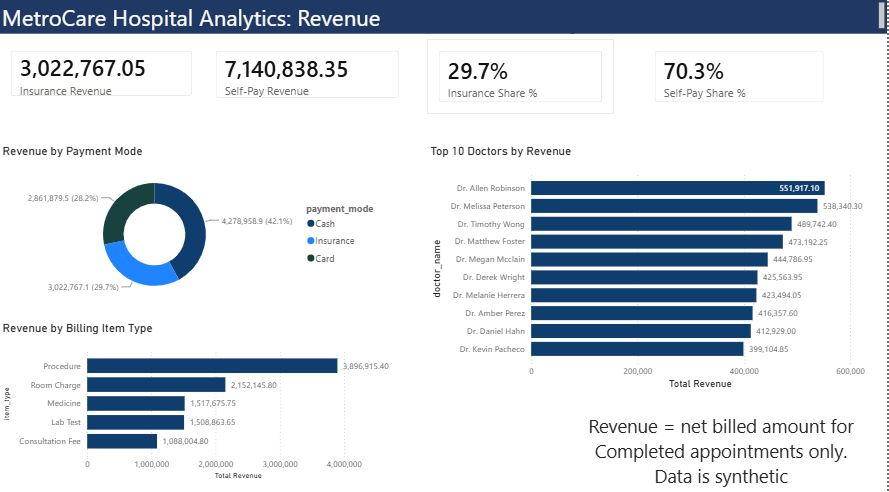
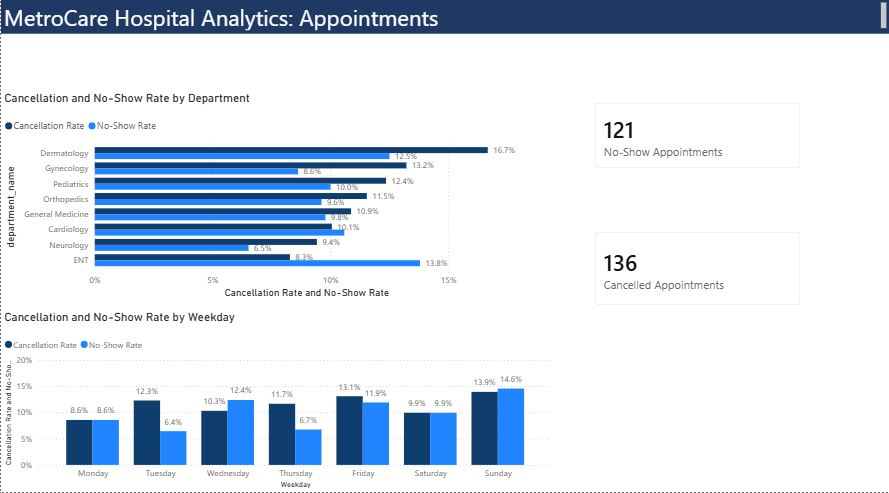

# MetroCare Hospital Analytics

End-to-end analysis of hospital appointment and billing data: data cleaning and analysis in PostgreSQL, and a 3-page Power BI dashboard.

**Note:** The dataset is synthetic.

## Tools
PostgreSQL, SQL (views, aggregations), Power BI, DAX

## Data
Six tables in PostgreSQL: appointments (1,200 rows), billing_items (2,315), patients (300), doctors (26), departments (8), insurance_providers (6). Appointments span 2024-08-01 to 2025-07-31.

## Data cleaning
The appointment_status and payment_mode columns had mixed spellings and letter case (for example INS, Insurance Claim and Ins Claim all meant Insurance). I standardized them in a SQL view, `appointments_clean`, and checked that the counts still reconciled to 1,200 appointments.

## Revenue definition
Revenue = net billed amount (quantity x unit price, after discount_pct) for Completed appointments only. Cancelled and Scheduled appointments have no bills.

## Key findings
- 1,200 appointments: 878 Completed, 136 Cancelled, 121 No-Show, 65 Scheduled
- Cancellation rate 11.3% and no-show rate 10.1%
- Completed-appointment net revenue: 10,163,605.40
- Cardiology is the top department (17.4% of revenue); Dermatology is the lowest (7.0%)
- Monthly revenue peaked in 2024-11 and was lowest in 2025-05
- Self-pay (Cash + Card) is 70.3% of revenue; Insurance is 29.7%
- Procedures are the largest billing item type (38.3%)
- Sunday has the highest cancellation (13.9%) and no-show (14.6%) rates

## Dashboard
**Overview**

**Revenue**

**Appointments**

## Files
- `metrocare_analysis.sql`: cleaning view and all analysis queries
- `MetroCare Dashboard.pbix`: Power BI dashboard (if uploaded)
